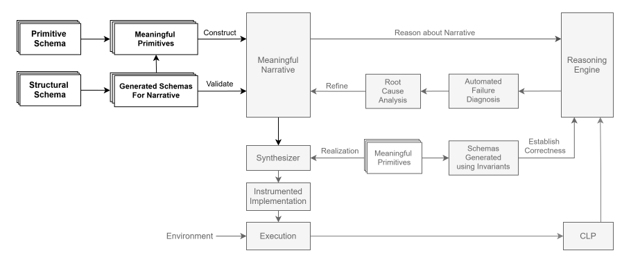

# Artha Primitives

A collection of primitives used in the Artha language. This repo currently specifies the schema for each primitive type and contains specifications built and validated using the primitive schema. It also contains a docusaurus server that aggregates all the information and also contains a report of the primitive validation using the schema.

The repo will be extended to include schemas generated from the established primitives to validate the use of the primitives. It will also use the invariants to validate the correctness of how the primitive is used in a narrative. The entire process will draw from a single source of truth and this is laying the foundation for that process.



# Documentation

Documentation can be found [here][docs].

The documentation is built using docusaurus and the contents including the validation reports are generated using a Nodejs script and included in the docusaurus docs folder.

# Usage

The steps below demonstrate how to install the libraries, generate the documentation, start the docusaurus server and build the docusaurus server.

### Install Libraries

```
npm run install:all
```
This command installs both the docusaurus packages and the artha-primitive packages.

### Generate Documentation

```
npm run generate-documentation
```
This command generates documentation for the primitives and places them in the docs folder in the docusaurus directory (called docs, so the path is ./docs/docs). It also validates the primitives using the schema and produces a report establishing the validity of the primitives.

### Start Documentation Server
```
npm run start
```
This command first generates the documentation and then starts the docusaurus server. The site can be found at url http://localhost:3000/artha-primitives.

### Build Documentation
```
npm run build
```
This command regenerates the documentation and then builds the docusaurus server and saves the output in the `docs/build` folder. To serve the built site, please see the serve documentation below.

### Serve Built Documentation
```
npm run serve
```
This command serves the built documentation contained in the build folder inside the docs folder.

### Publish on GitHub Pages
```
npm run deploy
```
This command deploys the build documentation site to github pages.

# Providing feedback

You can use GitHub issues to [report a bug][bug-report] or [request a feature][feature-req].

[bug-report]: https://github.com/vishalpalaniappan/artha-primitives/issues
[feature-req]: https://github.com/vishalpalaniappan/artha-primitives/issues
[docs]: https://vishalpalaniappan.github.io/artha-primitives/